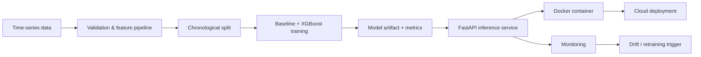

# Production Time-Series Forecasting & MLOps Demo

> **Hiring-manager quick demo:** [Run the forecasting project in 5 minutes](RECRUITER_QUICKSTART.md) — includes a sample API request, interview talking points, and explicit demo limitations.

A compact, production-oriented forecasting project built around the same class of multivariate sensor/time-series problems used in my research. The goal is to demonstrate the engineering steps required to move a forecasting model from an experiment into a reliable service.

## Why this repository

My research already covers time-series forecasting, IoT/CPS data, model validation, and automated ML workflows. This repository adds a focused **MLOps and deployment layer**:

- chronological train/validation/test splitting
- lag and rolling-window features
- baseline vs. ML model comparison
- reproducible training pipeline
- model serialization and metadata
- REST inference API with FastAPI
- Docker packaging
- unit tests
- GitHub Actions CI
- prediction/data-drift monitoring hooks
- leakage-aware SQL feature extraction example
- cloud-ready AWS deployment mapping
- provider-agnostic GenAI/RAG/agentic-AI portfolio demo with retrieval, tool routing, groundedness checks and evaluation

## Architecture



## Tech stack

Python, SQL, pandas, scikit-learn, XGBoost, FastAPI, Pydantic, joblib, Docker, pytest, GitHub Actions.

## Quick start

```bash
python -m venv .venv
source .venv/bin/activate
pip install -r requirements.txt
python -m src.generate_data
python -m src.train
uvicorn src.api:app --host 0.0.0.0 --port 8000
```

Then open `http://localhost:8000/docs`.

## Docker

```bash
docker build -t forecasting-api .
docker run -p 8000:8000 forecasting-api
```

## Validation strategy

Random splitting is intentionally avoided. For time-series data, training observations must precede validation/test observations to prevent future information leaking into the past. The pipeline also fits preprocessing only on training data.

## SQL feature example

`sql/forecast_features.sql` shows how lagged and rolling forecasting features can be created with SQL window functions while excluding the current target from rolling statistics. This keeps feature generation aligned with information that would actually be available at prediction time.

## SQL time-series analytics mini-project

**[River Station SQL Analytics — runnable portfolio exercise](sql/station_analytics/README.md)**

A separate **folder within this same repository** (not another repo) demonstrates SQLite database design, joins, aggregates, CTEs, ROW_NUMBER(), LAG(), gap-aware historical features, and five tested data-quality/leakage checks using only synthetic station data. Run it with Python's standard library; it does not claim professional database production experience.

## Monitoring

The monitoring module provides simple production hooks for:

- missing-input checks
- feature-distribution drift
- prediction drift
- rolling error tracking when actuals become available
- retraining recommendations

## GenAI / RAG / Agentic AI portfolio demo

The `genai_rag_demo/` folder adds a small, provider-agnostic implementation that demonstrates concepts requested in modern enterprise AI roles:

- Retrieval-Augmented Generation control flow
- grounded prompt construction
- tool/function routing for agentic workflows
- retrieval-quality evaluation
- groundedness / hallucination-risk checks
- regression tests for retrieval and routing
- an explicit mapping to how the same application logic could be connected to Azure AI Search and Azure OpenAI / Azure AI Foundry

This is **portfolio evidence and hands-on practice**, not a claim of prior production ownership of Azure, commercial LLM infrastructure, or enterprise agent platforms.

## AWS mapping

This repository is deliberately cloud-provider neutral, but the same components can be mapped to AWS:

| Local component | AWS equivalent |
|---|---|
| Training script | SageMaker Training Job |
| Model artifact | S3 / SageMaker Model Registry |
| Docker image | ECR |
| FastAPI service | ECS/Fargate or SageMaker Endpoint |
| Scheduled retraining | EventBridge + Step Functions/SageMaker Pipelines |
| Monitoring | CloudWatch + SageMaker Model Monitor |
| Metadata/metrics | MLflow or SageMaker Experiments |

This is an implementation-oriented demonstration of cloud readiness; it does **not** claim prior production ownership of AWS infrastructure.

## Interview talking points

1. Why chronological validation matters for forecasting.
2. How leakage can enter feature engineering, preprocessing, and SQL feature creation.
3. Why a baseline must be compared with a more complex model.
4. How training-serving skew is prevented by sharing feature code.
5. What should be monitored after deployment.
6. What events should trigger retraining.
7. How the local architecture maps to SageMaker/ECR/CloudWatch.
8. How a RAG application separates retrieval, orchestration, tool calling, evaluation, and provider-specific LLM integration.
9. How groundedness checks and structured evaluation can reduce hallucination risk.

## Relation to my work

This repository complements my ML2++ and AI4RIVER work by showing a small, inspectable path from **time-series data -> validated model -> API -> container -> CI -> monitoring**, plus a separate **retrieval -> grounded prompt -> tool routing -> evaluation** GenAI workflow.
